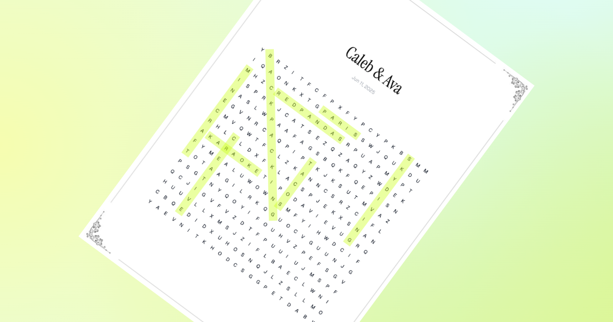

Wordamour es un rompecabezas de búsqueda de palabras personalizado para tu persona especial. [¡Crea uno](https://wordamour.com)!

## Contáctanos

Si tienes sugerencias sobre cómo mejorar Wordamour o has encontrado un error, ¡no dudes en abrir una incidencia!

Si Wordamour le saca una sonrisa a tu persona especial, considera [invitarme un café](https://buymeacoffee.com/anandbaburajan).

## Agradecimientos

Gracias a @blex41 por [word-search](https://github.com/blex41/word-search), a @ivmarcos por [react-to-pdf](https://github.com/ivmarcos/react-to-pdf), a Freepik por los [elementos de esquina](https://www.freepik.com/free-vector/vector-vintage-corners-elements-frames-page-decoration_10700746.htm) en las páginas y a las [otras maravillosas bibliotecas](https://github.com/anandbaburajan/wordamour/blob/main/package.json) utilizadas para construir Wordamour.

## Licencia

Wordamour se distribuye bajo la [licencia](https://github.com/anandbaburajan/wordamour/blob/main/LICENSE) MIT.
